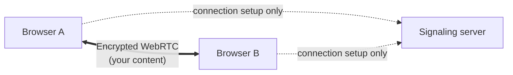

# PeerBoard

A real-time whiteboard and notes app where browsers sync **directly with each other**.
No server stores or even sees your content.

**[Live demo → peerboard.vercel.app](https://peerboard.vercel.app/)**

## Try it in 30 seconds

1. Open the [live demo](https://peerboard.vercel.app/) and click **Create a room**.
2. Click **Share** to copy the link, then open it in another window or on your phone.
3. Draw or type in one window and watch it appear in the other.

The first connection can take up to a minute while the free-tier signaling server wakes up.

## Features

- **Whiteboard:** pen, rectangle, ellipse, arrow, and text. Move, resize, rotate, pan, zoom,
  and export to PNG.
- **Shared notes:** rich text with live cursors that show each person's name.
- **Live presence:** see who is online, where their cursor is, and their connection speed.
- **Personal undo:** undo removes only your own changes, never someone else's.
- **Works offline:** keep editing without a connection; changes merge when you reconnect.
- **End-to-end encrypted:** the room key lives in the link and never reaches a server.

## How it works



1. **Find each other.** Browsers join a room on a small signaling server, which only passes
   connection details between them.
2. **Connect directly.** Each pair of browsers opens an encrypted WebRTC data channel.
3. **Stay in sync.** [Yjs](https://yjs.dev), a CRDT library, merges everyone's edits so all
   copies end up identical, even after working offline.

More detail: [architecture](docs/architecture.md) · [security model](docs/security.md)

## Tech stack

| Area      | Tools                                                                   |
| --------- | ----------------------------------------------------------------------- |
| Frontend  | Next.js 16, React 19, Tailwind CSS 4, Tiptap (notes), Konva (board)     |
| Real-time | WebRTC, Yjs, a custom sync provider (`packages/provider`)               |
| Server    | Node.js, Socket.IO (signaling only)                                     |
| Security  | AES-GCM 256 via the Web Crypto API                                      |
| Quality   | TypeScript strict, Vitest, Playwright, ESLint, Prettier, GitHub Actions |

## Highlights

| Metric                                        | Result                        |
| --------------------------------------------- | ----------------------------- |
| Sync latency between two browsers             | 5 ms median                   |
| Whiteboard with 1,000 / 5,000 shapes          | 60 / 53 fps while panning     |
| Size of one shape edit on a 5,000-shape board | 75 bytes (full board: 311 KB) |

All numbers and how to reproduce them: [benchmarks](docs/benchmarks.md)

## Run locally

You need Node.js 20+ and pnpm 9.

```bash
pnpm install
pnpm dev
```

Then open http://localhost:3000. This starts the web app on port 3000 and the signaling
server on port 4000.

| Command                                 | What it does                     |
| --------------------------------------- | -------------------------------- |
| `pnpm test`                             | Run unit tests                   |
| `pnpm lint`                             | Check code style                 |
| `pnpm typecheck`                        | Check types                      |
| `pnpm build`                            | Build everything                 |
| `pnpm bench`                            | Run sync benchmarks              |
| `pnpm --filter @peerboard/web test:e2e` | Run browser tests with two users |

## Project structure

```
apps/
  web/          the Next.js app
  signaling/    the signaling server
packages/
  provider/     the custom Yjs WebRTC sync provider
  shared/       message types shared by server and client
docs/           architecture, decisions, security, benchmarks
```

## Documentation

- [Architecture](docs/architecture.md): diagrams, connection flow, message format
- [Design decisions](docs/adr): why peer-to-peer, why Yjs, why a custom provider
- [Security model](docs/security.md): what encryption protects, and what it does not
- [Benchmarks](docs/benchmarks.md): measurements and how to reproduce them
- [Deployment](docs/deployment.md): Vercel, Render, environment variables, TURN

## Limitations

- **Up to 6 people per room.** Every browser connects to every other one, which stops scaling
  beyond that.
- **Rooms need at least one person.** If everyone leaves, a new visitor starts with an empty
  board. Use **Export backup** in the room menu to keep a copy.
- **Anyone with the link can join.** There are no accounts or access controls.
- **Some strict networks** need a TURN relay to connect. See [deployment](docs/deployment.md#turn-optional).

## License

MIT
