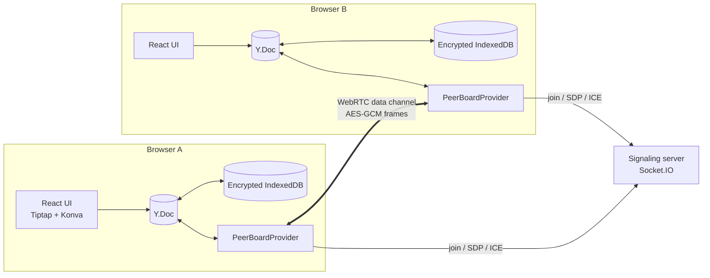
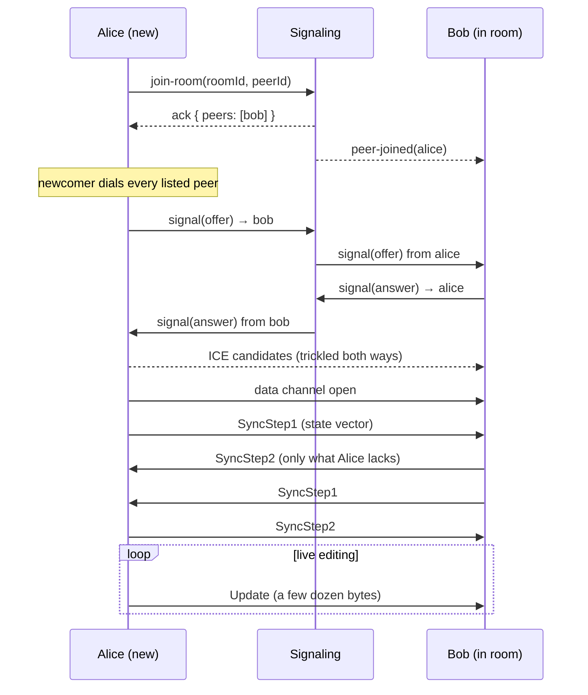

# Architecture

PeerBoard has three moving parts. Only one of them runs on a server, and that one never sees
document content.



| Part                                     | Runs in | Knows about                                     |
| ---------------------------------------- | ------- | ----------------------------------------------- |
| `apps/web`: Next.js UI                   | Browser | Everything: it is the user's own app            |
| `packages/provider`: Yjs provider        | Browser | Document updates, the room key                  |
| `apps/signaling`: Socket.IO relay        | Server  | Room ids, random peer ids, opaque SDP/ICE blobs |
| `packages/shared`: wire contract (types) | Both    | The shape of signaling messages                 |

## Connection lifecycle



## Provider layering

The provider is split so the protocol logic can be tested without browsers:

```
PeerBoardProvider            glue, E2EE pipeline, stats, ICE config refresh
├── SignalingClient          typed Socket.IO wrapper, auto re-join after reconnect
├── PeerConnectionManager    full mesh: one PeerConnection per remote peer
│   └── PeerConnection       RTCPeerConnection + perfect negotiation + ICE restart
└── SyncEngine               y-protocols sync + awareness over any FrameTransport
EncryptedIndexedDbPersistence  offline storage, sealed with the room key
```

`SyncEngine` only needs a `FrameTransport` (`send(peerId, frame)` / `broadcast(frame)`). In
production that is the WebRTC mesh; in unit tests it is an in-memory network with randomized
delivery order, which is how convergence is verified (`packages/provider/test`).

## Data channel framing

Every frame is `[messageType: varUint][payload]`, then sealed with AES-GCM
(`[iv: 12 bytes][ciphertext + tag]`, additional data = `peerboard:rtc:<roomId>`).

| Type | Name      | Payload                                            |
| ---- | --------- | -------------------------------------------------- |
| 0    | Sync      | y-protocols sync message (step 1, step 2, update)  |
| 1    | Awareness | y-protocols awareness update (presence, cursors)   |
| 2    | Ping      | float64 timestamp                                  |
| 3    | Pong      | echoed timestamp, used for the RTT shown in the UI |

Unknown types are ignored, so newer clients can add messages without breaking older ones.

## Document model

| Y type                   | Used by    | Notes                                                   |
| ------------------------ | ---------- | ------------------------------------------------------- |
| `Y.XmlFragment('notes')` | Tiptap     | Rich text via `@tiptap/extension-collaboration`         |
| `Y.Map('shapes')`        | Whiteboard | `shapeId → Shape` plain objects, replaced on every edit |

Awareness state per client: `{ user: { name, color }, peerId, pointer }`, plus `cursor`, which
y-prosemirror owns for text selections.

## Ordering guarantees

- Data channels are `ordered: true`, and each peer's outgoing frames pass through one promise
  chain, so async encryption cannot reorder them.
- Incoming frames are decrypted through a per-peer chain for the same reason.
- Yjs itself tolerates reordering (it buffers updates with missing dependencies), so ordering is
  about efficiency, not correctness.
